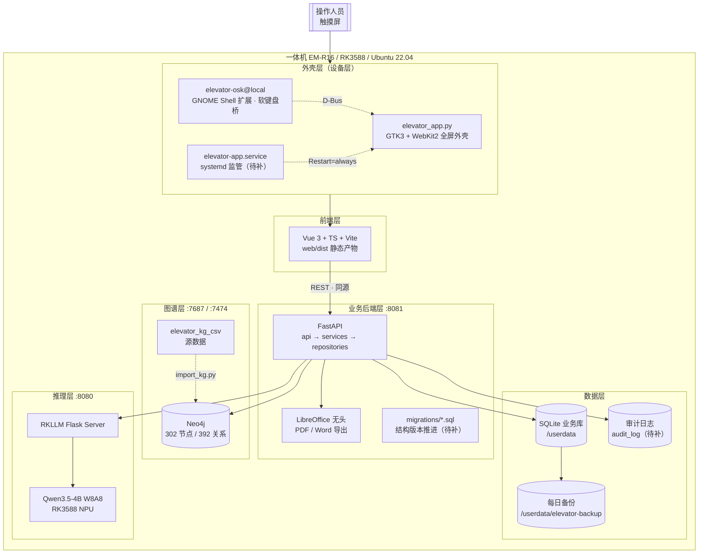

# 系统架构设计 v1

在用曳引驱动电梯安全评估系统 —— 整体框架

| 项目 | 内容 |
|---|---|
| 版本 | v1 |
| 日期 | 2026-10-12 |
| 状态 | 待评审 |
| 范围 | 设备层 / 推理层 / 图谱层 / 业务后端 / 前端 / 数据 / 运维交付 / 安全合规 |
| 配套文档 | `前端架构设计-v1.md`、`终端数据方案-v1.md`、`docs/prd/PRD-JTE报告模板对齐与交互优化-v0.2.md` |

---

## 1. 目标与原则

### 1.1 目标

把当前「能演示」的系统，变成「能交付、能维护、出事能恢复」的系统。判定标准是四条：

1. **可运行**：开机自启，断电重启后无需人工干预即可回到可用状态。
2. **可恢复**：任何一层挂掉都有明确表现与恢复路径，不出现无法诊断的静默失败。
3. **可追溯**：谁在什么时候做了什么，事后查得到；报告内容是否被改动，校验得出。
4. **可演进**：离线环境下能安全升级、能回滚、能迁移数据结构。

### 1.2 原则

| 原则 | 含义 |
|---|---|
| 单机自洽 | 一体机不依赖外部服务即可完成全部业务；网络是可选项，不是前提 |
| 事实可溯 | 风险与措施必须来自知识图谱，大模型只负责表述，不参与定级 |
| 分层隔离 | 设备层、业务层、数据层各自可独立替换与测试 |
| 失败可见 | 任何降级都要在界面上有明确状态，不允许静默失败 |
| 尽量少依赖 | 板端离线，新增运行时依赖的代价极高，能不加就不加 |

---

## 2. 总体架构



七个部分，各自独立演进，通过明确定义的接口连接。以下逐层说明。

---

## 3. 设备层（板端）

### 3.1 组成

| 组件 | 位置 | 作用 |
|---|---|---|
| 原生外壳 | `/home/user/elevator_app.py` | GTK3 + WebKit2 全屏窗口，加载 `http://127.0.0.1:8081/` |
| 启动包装 | `/home/user/elevator-launch.sh` | 注入输入法与显示相关环境变量后拉起外壳 |
| 备用外壳 | `/home/user/elevator-kiosk.sh` | Chromium kiosk 方案，带就绪轮询与重启循环 |
| 软键盘桥 | `~/.local/share/gnome-shell/extensions/elevator-osk@local` | 经 D-Bus 让输入框获得焦点时弹出系统软键盘 |
| 桌面加固 | `kiosk/harden_kiosk.sh` | 关锁屏、关热区、解除退回桌面快捷键、隐藏桌面图标 |
| 服务编排 | `/etc/systemd/system/*.service` | neo4j / elevator-rkllm / elevator-api 三个服务 |

### 3.2 实测发现的问题

| 问题 | 实测证据 | 影响 |
|---|---|---|
| **GTK 外壳没有监管** | `elevator_app.py` 由 `elevator-launch.sh` 用 `setsid nohup` 拉起，systemd 里只有 api/rkllm/neo4j 三个服务，没有应用服务 | 外壳崩溃后无人重启，屏幕停在桌面或被加固隐藏的空屏，现场表现为「机器黑了」 |
| **项目目录权限为 777** | `/home/ubuntu/elevator` 及其下 `backend`、`rkllm`、`web` 均为 `drwxrwxrwx` | GUI 用户 `user` 可改写后端代码，而服务以 root 运行，构成提权路径 |
| **`.env` 全局可写** | `-rw-rw-rw- 1 root root backend/.env` | 内含 Neo4j 与管理员口令；被改写后可把服务指向别处 |
| **无版本标识** | 项目根目录没有 `VERSION` 文件，接口也没有版本端点 | 现场无法判断板子上跑的是哪一版，排障与回滚都困难 |
| **无回滚机制** | 部署是 `adb push` 覆盖原文件 | 推错一版就直接破坏现场，只能人工修复 |

### 3.3 目标形态

1. **外壳纳入 systemd 监管**：新增 `elevator-app.service`（`Restart=always`、`RestartSec=5`），与 api 服务同级，不再是「孤儿进程」。
2. **权限收紧**：

```text
/home/ubuntu/elevator             root:root  755
  backend/  web/  kiosk/ ...       root:root  755
  backend/.env                     root:root  600
  backend/data/                    root:root  700
/userdata/elevator/                专用目录    700
```

3. **版本标识**：项目根目录放 `VERSION`，后端增加 `GET /api/version` 返回版本号、构建时间、模型名、图谱版本。
4. **健康自检**：`/api/health/ready` 已存在（api + Neo4j），补一个面向运维的 `GET /api/health/full`，一次返回三个服务、磁盘水位、时间是否正确。

---

## 4. 推理层

| 项 | 现状 |
|---|---|
| 服务 | `elevator-rkllm.service`，Flask + RKLLM，监听 `0.0.0.0:8080` |
| 模型 | `Qwen3.5-4B_W8A8_RK3588.rkllm`，5.2 GB |
| 接口 | `POST /v1/chat/completions`（OpenAI 兼容），支持流式 |
| 运行时 | RKLLM 1.3.0，`librkllmrt.so` 需同时位于 `/usr/lib` 与 `rkllm/lib/` |

**要补的**：

1. 模型目录里 4.6 GB 的旧模型 `Qwen3-4B-Instruct-2507` 已停用，确认后回收。
2. 模型加载耗时长，`elevator-api` 目前只 `After=elevator-rkllm.service`，不校验其是否真正就绪；应由前端轮询 `/api/health/full` 判断。
3. 推理失败必须降级为「图谱结果」而非报错，这条逻辑已在 `llm_service.generate_or_fallback` 中实现，保留。

---

## 5. 图谱层

| 项 | 现状 |
|---|---|
| 数据库 | Neo4j，`bolt://127.0.0.1:7687`，HTTP `7474` |
| 数据量 | 302 节点、392 关系，数据目录 517 MB |
| 源数据 | `elevator_kg_csv/` 十个 CSV，文件与板端完全一致 |
| 导入 | `backend/import_kg.py`（**会先 `DETACH DELETE` 清空再导入**） |
| 查询 | `app/services/kg_service.py`，443 行 |

**要补的**：

1. **导入脚本必须幂等**。当前用 `CREATE`，重复运行会生成重复节点；且开头的全库清空动作在误操作时不可逆。改为 `MERGE` + 事务，并在清空前强制备份。
2. **拆分 `kg_service.py`**：查询构造与结果整形分离，443 行拆成两三个文件。
3. **图谱版本号**：CSV 变更后需要能标识版本，与 `VERSION` 一起暴露，便于判断报告依据的是哪一版知识。
4. **条目映射（关键）**：模板有 66 条评价条目，图谱有 41 条 `INS_*` 检测项，两者不是一一对应。不建立映射，「点不符合→查图谱」这条链路就走不通。这是当前最大的未决项。

---

## 6. 业务后端层

### 6.1 现状

框架本身没问题——**已经在用 FastAPI**，配套 uvicorn、Pydantic v2、pydantic-settings、Neo4j driver、httpx。问题是工程化不足：

```text
Python 文件 21 个，合计 2,326 行
最大单文件：app/services/kg_service.py  443 行
测试文件：0 个
迁移机制：无（db.py 只有 CREATE TABLE IF NOT EXISTS）
```

具体表现：没有数据访问层（`api/history.py` 173 行里全是裸 SQL）；报告 HTML 靠字符串拼接；日志用 `print`；异常处理分散在各路由；`config.py` 里硬编码 `admin123` / `12345678`；同步与异步函数混用；历史接口无分页。

### 6.2 目标形态

```text
backend/
├─ app/
│  ├─ main.py              应用装配：路由、中间件、静态挂载、生命周期
│  ├─ config.py            配置（无默认口令，缺失即启动失败）
│  ├─ api/                 HTTP 层：参数校验、调用 service、组装响应
│  ├─ services/            业务规则，不含 SQL
│  ├─ repositories/        数据访问，唯一写 SQL 的地方
│  ├─ kg/                  图谱查询构造 + 结果整形（由 kg_service 拆出）
│  ├─ models/schemas.py    Pydantic 契约
│  ├─ templates/           报告 HTML 模板（Jinja2）
│  └─ core/                异常、日志、依赖注入
├─ migrations/             版本化 SQL 迁移
├─ tests/                  pytest
└─ pkgs/                   板端离线 wheel
```

### 6.3 技术决策

| 决策 | 选择 | 理由 |
|---|---|---|
| 是否引入 ORM | **不引入** | 4 张表、查询简单；板端离线新增 wheel 成本高，尤其 `greenlet` 是原生扩展 |
| 迁移方案 | 自建极简 runner + `migrations/*.sql` + `user_version` | 零新依赖，二十行代码 |
| 报告模板 | **Jinja2** | 已在离线 wheel 内（`jinja2` / `markupsafe`），零新增依赖 |
| 请求封装 | 原生 `fetch`（前端）/ `httpx`（后端调 RKLLM） | 已具备，不引 axios |
| 测试 | pytest + httpx（**仅开发机**） | 板端不需要跑测试，不增加板端依赖 |
| 日志 | 标准库 `logging` + JSON 格式 | 零依赖，便于 `diagnose.sh` 采集 |

### 6.4 必须修的项

1. 移除 `config.py` 中的默认口令，改为必须由 `.env` 提供；缺失则启动失败并给出明确提示。
2. 首次登录强制修改预置管理员口令。
3. 统一异常处理与错误响应格式。
4. 新增 `GET /api/version` 与 `GET /api/health/full`。
5. 历史接口加分页。

> 详细分层与目录见 `前端架构设计-v1.md` 的对应章节思路，后端同样适用。

---

## 7. 前端层

现状：单个 `index.html`（88 KB）+ `marked.min.js`，无框架、无构建、逻辑集中在约 100 个函数中。

目标：**Vue 3 + TypeScript + Vite + Pinia + Vue Router（hash）+ 自研轻量组件**，蓝本参照 [vue-pure-admin](https://github.com/pure-admin/vue-pure-admin)（单仓库、MIT、极稳定）的目录约定，但不引入其 Element Plus 组件库与十几个 demo 模块。

关键适配：视口为竖屏 600×960 / 横屏 960×600（Mutter scale=2），断点取 900px；报告预览整体等比缩放而非重排。

> 详见 `前端架构设计-v1.md`。

---

## 8. 数据层

分三层，互不干扰：

| 层 | 位置 | 体积 | 变更频率 | 策略 |
|---|---|---|---|---|
| 图谱数据 | `/var/lib/neo4j/data` | 517 MB | 极低 | 随版本发布，业务数据不在此 |
| 业务数据 | `backend/data/elevator.db` | 204 KB | 每次操作 | 必须备份、可迁移、可追溯 |
| 导出产物 | `/home/user/导出/` | 每次 +210 KB | 只增 | 保留期 + 清理 |

**当前最严重的两个隐患**（实测发现）：

1. **硬件时钟停在 2021-01-01**，且 `System clock synchronized: no`。断电又无网络时，报告日期会出错——报告是法律文件，日期错等于作废。
2. **业务库放在系统分区且无备份、无迁移机制**（`user_version = 0`）。重刷系统或换板即丢数据，改表结构会破坏现场库。

**要补的**：时间可信（RTC + 开机校时 + 应用层年份拦截）、业务库迁至 `/userdata` 并每日备份、版本化迁移、导出与日志的容量治理、审计日志、数据出板通道。

> 详见 `终端数据方案-v1.md`。

---

## 9. 运维与交付层

### 9.1 现状

部署靠 `push.bat` 走 adb：直接 `adb push` 覆盖板端文件，然后 `systemctl restart elevator-api`。

问题：**没有回滚、没有校验、没有版本**。推错一版就直接破坏现场；推完是死是活只能靠人去看；出问题时不知道回退到哪一版。

### 9.2 目标形态

```text
发布流程：
  1. 构建前端（npm run build）
  2. 快照当前板端状态 → /userdata/releases/<时间戳>/
  3. 推送新版本
  4. 重启服务
  5. 自动校验（见 9.3）
  6. 校验失败自动回滚到上一快照
```

**快照式回滚（推荐先做）**：不改变现有目录结构，每次发布前把板端现有内容打包到 `/userdata/releases/`，并提供 `rollback.sh` 一键还原。成本低、见效快。

**软链切换发布（可选进阶）**：`/opt/elevator/releases/<版本>` + `current` 软链，systemd 指向 `current`，切换即生效、回退即改链。改造面较大，可在稳定运行一段时间后再做。

### 9.3 部署后自动校验

必须自动化，因为「白屏」在板端几乎无法排查：

| 检查 | 方法 | 失败含义 |
|---|---|---|
| 后端起来了吗 | `curl -sf /api/health` | 服务未启动 |
| 依赖就绪吗 | `curl -sf /api/health/ready` | Neo4j 未就绪 |
| 前端产物在吗 | `curl -sf /` 且页面引用的 `/assets/*` 全部 200 | 构建产物与后端路径不匹配 → 白屏 |
| 版本对不对 | `curl -sf /api/version` 比对期望版本 | 推送不完整 |
| 外壳在跑吗 | 检查 `elevator-app.service` 为 active | 应用未启动 |

### 9.4 离线依赖管理

板端 apt / pip 全不可用，所有 Python 依赖必须以 aarch64 wheel 形式预置在 `backend/pkgs/`（现有 38 个）。

**要补的**：生成 `pkgs/manifest.txt` 记录每个 wheel 的名称、版本、SHA-256；安装脚本按清单校验后再安装。否则某天换台机器装依赖，装了个不一样的版本，问题极难定位。

> 已发现版本漂移：板端 `fastapi` 是 0.138.0，而 `pkgs/` 里是 0.136.3。此类不一致必须有清单来暴露。

### 9.5 诊断包

新增 `kiosk/diagnose.sh`，一键采集：三个服务状态、端口占用、磁盘水位、系统时间与 RTC、`/api/health/full`、最近日志（api / rkllm / app）、版本信息、`pip list` 关键包版本。输出单个 tar 包，便于带回分析。现场排障时这一条能省掉大量来回问询。

---

## 10. 安全与合规

### 10.1 实测发现

| 问题 | 证据 | 风险 |
|---|---|---|
| **接口对整个局域网开放** | `elevator-api.service` 监听 `0.0.0.0:8081`；`elevator-rkllm.service` 监听 `0.0.0.0:8080`；板子 `wlan0` 在 `10.110.41.118/16` | 同网段任何人可访问 API 与模型接口；叠加默认口令即为实际入侵面 |
| **目录 777 + `.env` 666** | 项目目录与 `.env` 均全局可写 | GUI 用户可改写 root 运行的代码，构成提权路径 |
| **默认口令未强改** | `config.py` 硬编码 `admin123` / `12345678` | 已知口令可直接登录 |
| **无审计** | 无 `audit_log` 表 | 出问题无法追溯 |

### 10.2 目标形态

1. **监听地址收紧**：若无局域网访问需求，`elevator-api` 与 `elevator-rkllm` 均改为监听 `127.0.0.1`；远程维护走 adb / ssh 隧道。若确实需要局域网访问，则必须同时做到：强口令、禁用默认账号、接口限流、仅暴露必要路径。
2. **权限模型**：代码目录 root:root 755，`.env` 600，数据目录 700，业务库归属专用账号。
3. **口令策略**：无默认口令；首次登录强制改密；口令强度校验；连续失败锁定。
4. **审计**：`audit_log` 覆盖登录、登出、生成、导出、删除、用户管理。
5. **报告受控**：报告编号、状态（草稿/已生成/已审核/已批准）、内容哈希。
6. **导出文件**：目录权限收紧，导出动作记审计。

> 合规相关的编号与状态规则需业务方确认，见第 18 节。

---

## 11. 横切能力

### 11.1 可观测性

| 能力 | 现状 | 目标 |
|---|---|---|
| 健康检查 | `/api/health`、`/api/health/ready` | 增加 `/api/health/full`（三服务 + 磁盘 + 时间） |
| 日志 | `print` + 应用日志无轮转 | 标准库 `logging`，JSON 格式，按大小轮转 |
| 版本 | 无 | `VERSION` 文件 + `/api/version` |
| 诊断 | 无 | `diagnose.sh` 一键打包 |

### 11.2 版本一致性

系统有四个独立版本，必须能同时看到，否则无法定位「为什么同一份报告两台机器结果不同」：

```text
应用版本    VERSION / git commit
图谱版本    elevator_kg_csv 的版本号
模型版本    Qwen3.5-4B_W8A8_RK3588.rkllm
契约版本    API 与前端构建产物
```

### 11.3 配置管理

- 板端 `.env` 为唯一真实配置，入库的只有 `.env.example`。
- 配置项缺失时**启动失败并明确报错**，不允许静默使用默认值。
- 前端构建期配置走 `VITE_*`，运行期不感知。

### 11.4 时区与编码

统一 `Asia/Shanghai`，全部 UTF-8。SQLite 时间统一用带时区的 ISO 格式写入，避免 `localtime` 在不同环境表现不一致（当前 `datetime('now','localtime')` 依赖系统时区设置）。

---

## 12. 运行时视图

### 12.1 进程与端口（实测）

| 进程 | 运行用户 | 端口 | 监管 | 备注 |
|---|---|---|---|---|
| `neo4j`（java） | `neo4j` | 7687 / 7474 | `neo4j.service` | 启动约 20～30 秒 |
| `flask_server.py` | root | 8080 | `elevator-rkllm.service` | 监听 `0.0.0.0`（待收紧） |
| `uvicorn app.main:app` | root | 8081 | `elevator-api.service` | 监听 `0.0.0.0`（待收紧） |
| `elevator_app.py` | `user` | — | **无（待补）** | GTK + WebKit2 全屏外壳 |
| `gnome-shell` + 扩展 | `user` | — | 会话自带 | 软键盘桥 |
| `fcitx5` | `user` | — | 会话自带 | 中文输入 |

### 12.2 启动顺序

```text
上电
 └─ systemd
     ├─ neo4j.service            （较慢，20～30 s）
     ├─ elevator-rkllm.service   （加载 5.2 GB 模型，较慢）
     └─ elevator-api.service     After 上面两个（但不校验其就绪）
 └─ 用户会话建立
     ├─ fcitx5、gnome-shell + elevator-osk@local
     └─ autostart → elevator-launch.sh → elevator_app.py
         └─ WebView 加载 127.0.0.1:8081
             └─ 前端轮询 /api/health/ready（最多 180 s）
```

**问题**：`elevator-api` 只按 `After=` 顺序启动，不等依赖就绪；真正判断就绪的是前端轮询。这在开机时可行，但**缺少服务端的就绪语义**，运维脚本无法据此判断。目标是把 `ExecStartPre` 或 systemd 的健康判定补齐。

---

## 13. 失败模式与降级矩阵

任何一层失效都必须有明确表现与恢复路径，不允许静默失败。

| 失效组件 | 现场表现 | 系统应有行为 | 恢复方式 |
|---|---|---|---|
| RKLLM 推理服务 | 无 AI 报告 | 展示知识图谱结果，界面标注「AI 报告暂不可用」 | systemd `Restart=always`；前端重新生成 |
| Neo4j 图谱 | 无法评估风险 | **禁止生成报告**；登录、草稿、历史仍可用 | 提示 + 自动重试；`/api/health/ready` 反映 |
| 业务后端 | 页面打不开 | 外壳显示「后端不可用」并提供重试 | systemd `Restart=always` |
| 外壳进程崩溃 | 黑屏或露出桌面 | 由 `elevator-app.service` 自动拉起 | `Restart=always` + `RestartSec=5` |
| 软键盘扩展失效 | 无法输入中文 | 界面提示，可先用英文完成 | `gnome-extensions enable elevator-osk@local` |
| 磁盘写满 | 导出失败 | 提前在水位低于 10% 时告警 | 清理导出与日志；回收旧模型 |
| 系统时间错误 | 报告日期错 | **拒绝生成报告**并提示校时 | RTC / 校时流程 |
| 导出（LibreOffice）失败 | 点导出无结果 | 明确报错，不静默 | 重试；检查 `soffice` 可用性 |

**优先级原则**：Neo4j 是事实基础，不可缺；RKLLM 是表达增强，可降级；外壳与后端必须自动恢复。

---

## 14. 版本与升级

### 14.1 离线升级流程

```text
1. 开发机：跑测试（前端 typecheck + vitest；后端 pytest）
2. 开发机：npm run build 产出前端 dist
3. 部署前：快照板端现状 → /userdata/releases/<时间戳>/
4. adb push 新版本
5. systemctl restart elevator-api（必要时含 rkllm）
6. 自动校验：健康检查 + 产物检查 + 版本比对（见 9.3）
7. 校验失败 → rollback.sh 还原上一快照
```

### 14.2 各类升级的差异

| 升级对象 | 方式 | 注意 |
|---|---|---|
| 前端产物 | 推 `dist` | 必须与后端静态挂载路径同时改，否则白屏 |
| 后端代码 | 推 `backend/app` | 启动时自动执行迁移 |
| 数据库结构 | `migrations/*.sql` | **禁止手工 ALTER**；迁移前自动备份 |
| 知识图谱 | `import_kg.py` | 需先幂等化改造，并在导入前备份 |
| 模型 | 单独流程 | 5.2 GB，需校验字节数与 SHA-256 |
| 外壳与扩展 | `install_kiosk.sh` | 扩展变更需重新登录桌面才生效 |

---

## 15. 目标目录形态

```text
大模型故障检测/
├─ backend/                 FastAPI 服务
│   ├─ app/{api,services,repositories,kg,models,templates,core}
│   ├─ migrations/          版本化 SQL
│   ├─ tests/               pytest
│   ├─ pkgs/ + manifest.txt 离线 wheel 与校验清单
│   ├─ data/                本机开发数据（板端用 /userdata）
│   └─ import_kg.py
├─ web/                     前端工程（Vue 3 + Vite）
│   ├─ src/{api,stores,domain,components,views,styles,utils}
│   ├─ public/  types/  build/  dist/（不入库）
│   └─ package.json  vite.config.ts  tsconfig.json  .env*
├─ native/                  elevator_app.py
├─ kiosk/                   安装、加固、systemd、诊断脚本
│   ├─ systemd/{elevator-api,elevator-rkllm,elevator-app,neo4j}.service
│   ├─ install_kiosk.sh  harden_kiosk.sh  diagnose.sh  rollback.sh
│   └─ README.md
├─ osk-helper/              GNOME Shell 软键盘扩展
├─ elevator_kg_csv/         图谱源数据
├─ docs/
│   ├─ design/              架构与数据方案
│   ├─ prd/                 PRD 与页面模板
│   └─ 规范与模板/           国标、报告模板、参考资料
├─ tools/                   gen_jte_items.py 等开发脚本
├─ push.bat                 构建 + 推送 + 校验
├─ VERSION
└─ README.md
```

---

## 16. 工程规范

| 项 | 规定 |
|---|---|
| 分支 | `main` 受保护，日常在功能分支开发，改动经审查后合并 |
| 提交信息 | 采用 `type(scope): 说明`，如 `feat(report): 支持不符合情形多选` |
| 前端风格 | Prettier 统一格式；`vue-tsc --noEmit` 通过；`strict: true` 不放松 |
| 后端风格 | 类型注解齐全；同层内保持同步或异步一致，不混用 |
| 测试门禁 | 前端 `npm run build`（含类型检查）+ Vitest；后端 pytest |
| 部署门禁 | 9.3 的自动校验全部通过，否则回滚 |
| 文档同步 | 架构、PRD、接口文档随代码同一次提交更新 |

---

## 17. 分期落地

### 一期（进行中）：前端框架化

Vue 3 + TS + Vite 工程、设计令牌与组件、登录、报告录入（66 条）、漏填校验与定位、预览（含风险评定值/附页/附录A）、导出、后端静态挂载与条目接口、`push.bat` 加校验。

### 二期：数据与设备加固（P0，上现场前必须完成）

时间可信（RTC + 校时 + 应用层拦截）、业务库迁 `/userdata` 并每日备份、版本化迁移、导出与日志容量治理、目录与 `.env` 权限收紧、服务监听收紧、`elevator-app.service` 监管、`diagnose.sh`、回收 4.6 GB 旧模型。

### 三期：后端工程化

`api → services → repositories` 分层、`kg_service` 拆分、Jinja2 报告模板、统一异常与响应、结构化日志、pytest 测试、历史分页、`/api/version` 与 `/api/health/full`。

### 四期：合规与汇总

报告编号与状态、审计日志增强、现场照片、数据出板通道（文件/局域网）、敏感数据加密（视需求）。

---

## 18. 待确认事项

| 编号 | 事项 | 影响层 | 优先级 |
|---|---|---|---|
| 1 | 66 条模板条目与图谱 41 条 `INS_*` 的映射规则 | 图谱 / 后端 / 前端 | **阻塞**，不做则「点不符合→查图谱」走不通 |
| 2 | 风险评定值（严重程度/概率等级/风险类别）取值规则 | 后端 / 前端 | **阻塞**，决定报告能否自动出值 |
| 3 | 现场部署是一台还是一批 | 数据 / 运维 | 高，决定是否需要汇总层与 UUID |
| 4 | 现场是否允许接入局域网/公网 | 运维 / 安全 | 高，决定数据出板路线与监听地址 |
| 5 | 报告是否需要统一编号与审核批准流程 | 数据 / 合规 | 高，决定数据模型与权限分级 |
| 6 | 报告历史与导出文件的保留期限 | 数据 | 中 |
| 7 | 附图页照片是否在本系统采集 | 前端 / 数据 | 中 |
| 8 | 后端是否按第 6.3 节的技术决策执行（不引 ORM） | 后端 | 中 |
| 9 | 是否需要为局域网保留 API 访问能力 | 安全 | 中 |

---

## 19. 决策记录

已定事项在此留痕，避免反复讨论。每条包含结论、日期与理由。

| 编号 | 决策 | 结论 | 日期 | 理由 |
|---|---|---|---|---|
| R-1 | 前端框架 | **Vue 3 + TypeScript + Vite + Pinia + Vue Router（hash）+ 自研组件** | 2026-10-12 | 蓝本参照 vue-pure-admin 的目录约定，不引入其 Element Plus 与 demo 模块 |
| R-2 | 后端框架 | **保留 FastAPI，补齐工程化，不引入 ORM** | 2026-10-12 | 4 张表查询简单；板端离线，避免新增原生依赖（greenlet） |
| R-3 | 报告生成方式 | **维持 HTML → LibreOffice 无头转换，不引入 docxtpl** | 2026-10-12 | 板端已装 LibreOffice，零新增依赖。代价是不使用原 docx 模板本身，改由 HTML 模板复刻全部可见元素，验收标准为「版式相似」而非「原模板本身」 |

### R-3 的连带影响

由于不再套用原始 docx，**所有版式元素都必须由我方 HTML 模板显式实现**，包括：

- 封面：质量体系文件编号 `GDSEI/JTE-09-R02-3.00`、标题、信息表、注意事项、机构联系方式
- 正文页：报告标题、21 行信息表、评估/审核/批准签署栏、检验机构核准证号
- 评价结果表：项目编号 / 项目 / 评价内容与要求 / 评价结果 / 风险评定值三列
- 附页：序号 / 项目编号 / 存在风险 / 风险类别 / 降低风险措施 + 页脚注
- 附录A：分值表、G 公式、等级表

字体按模板实测值：正文仿宋_GB2312，主力字号 10.5pt，表格线为黑色单实线。
